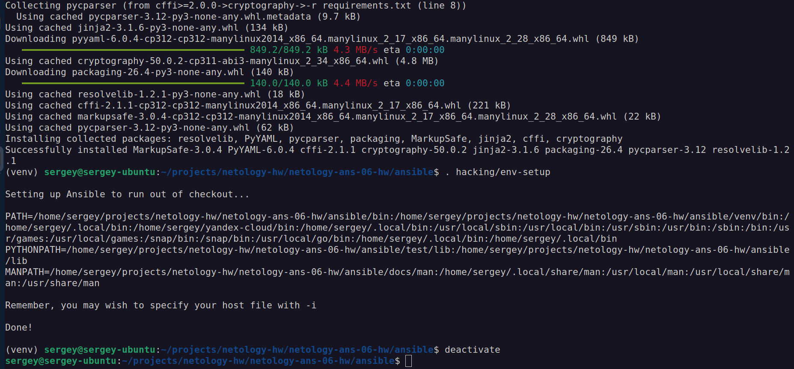
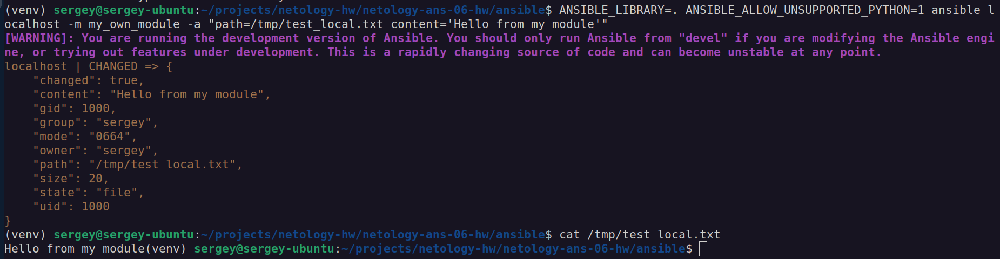
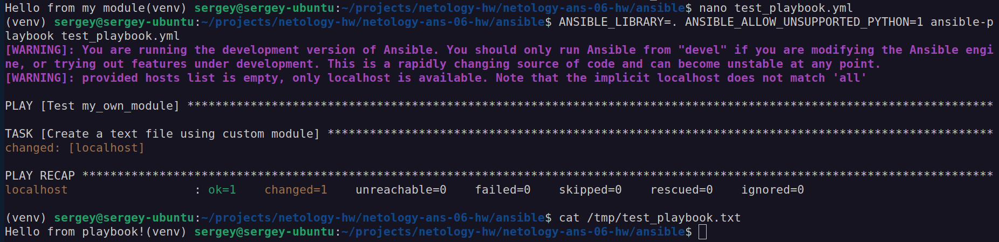
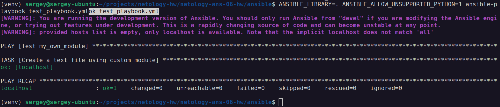
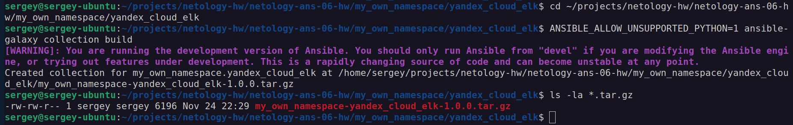
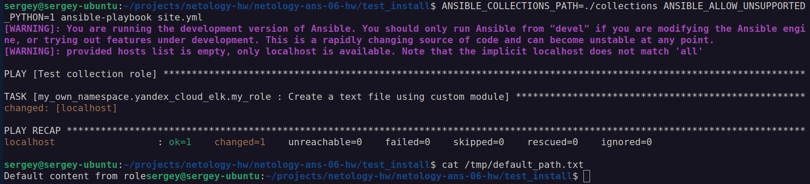

# Домашнее задание к занятию 6 «Создание собственных модулей» — Мешков Сергей

## Ссылки

*   **Исходный код коллекции:** [https://github.com/meshkov-sergey/my_own_collection](https://github.com/meshkov-sergey/my_own_collection)
*   **Собранный архив:** [my_own_namespace-yandex_cloud_elk-1.0.0.tar.gz](./my_own_namespace-yandex_cloud_elk-1.0.0.tar.gz)

---

## 1. Подготовка окружения

Согласно заданию, был склонирован репозиторий Ansible, создано виртуальное окружение (`venv`), установлены зависимости (`pip install -r requirements.txt`) и выполнена настройка через `. hacking/env-setup`.

---

## 2. Разработка модуля и локальная проверка (Пункты 1–4)

Был написан кастомный модуль `my_own_module.py`. Его задача — создавать текстовый файл по пути `path` с содержимым `content`. Модуль поддерживает идемпотентность: если файл уже существует и его содержимое совпадает, он не вносит изменений.

Модуль был проверен локально через `ansible localhost -m my_own_module`.

---

## 3. Playbook и идемпотентность (Пункты 5–6)

Затем был создан single task playbook, использующий наш модуль.

**Первый запуск** (файл создается, `changed: true`):

**Второй запуск** (идемпотентность, `changed: false`):

---

## 4. Упаковка в коллекцию (Пункты 8–13)

Модуль и роль были перенесены в коллекцию `my_own_namespace.yandex_cloud_elk`. Затем коллекция была собрана в архив `.tar.gz` командой `ansible-galaxy collection build`.

---

## 5. Установка и запуск из архива (Пункты 14–16)

Собранный архив был установлен в отдельную папку, после чего был запущен Playbook, использующий роль из установленной коллекции. Это подтвердило, что коллекция работает автономно.

---
## Автор
- **Студент**: Мешков Сергей
- **Курс**: Netology, DevOps
